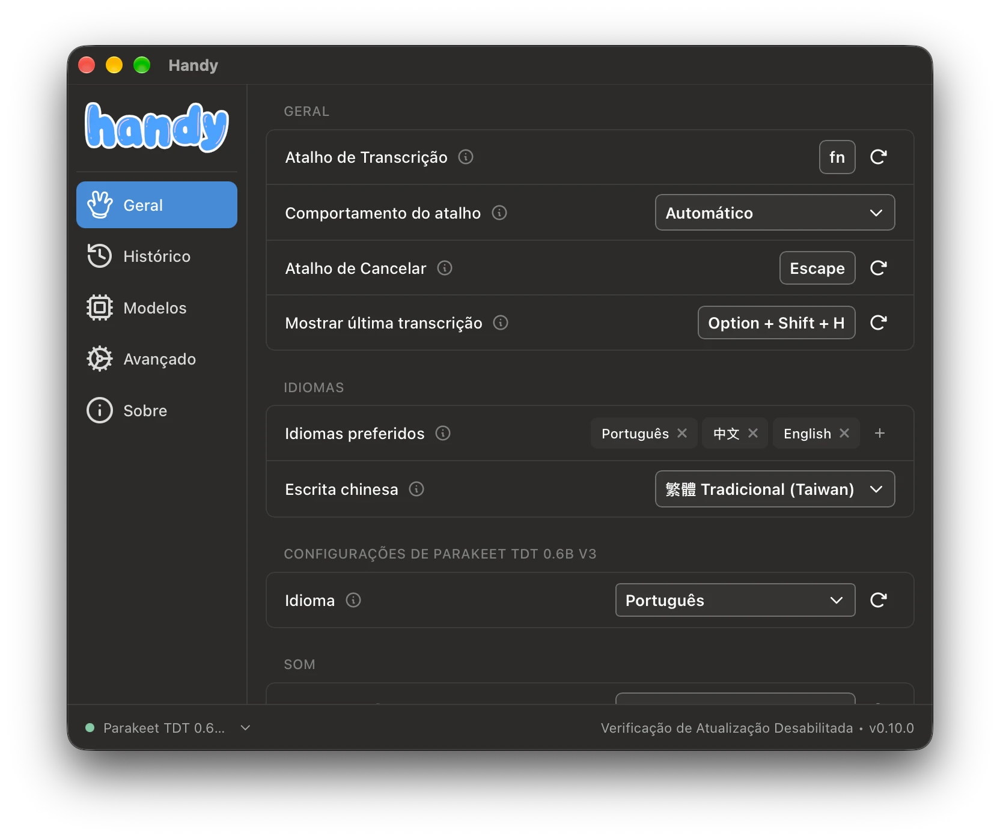
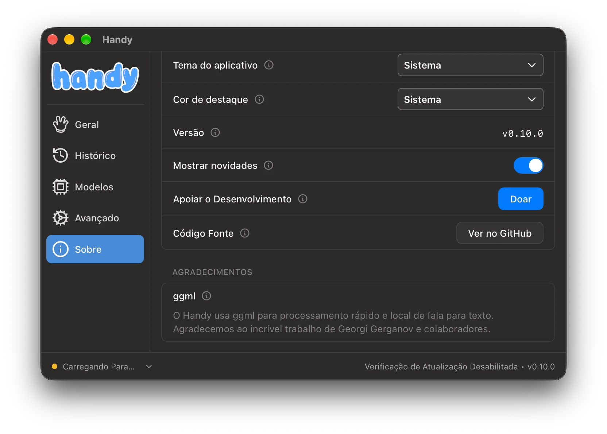
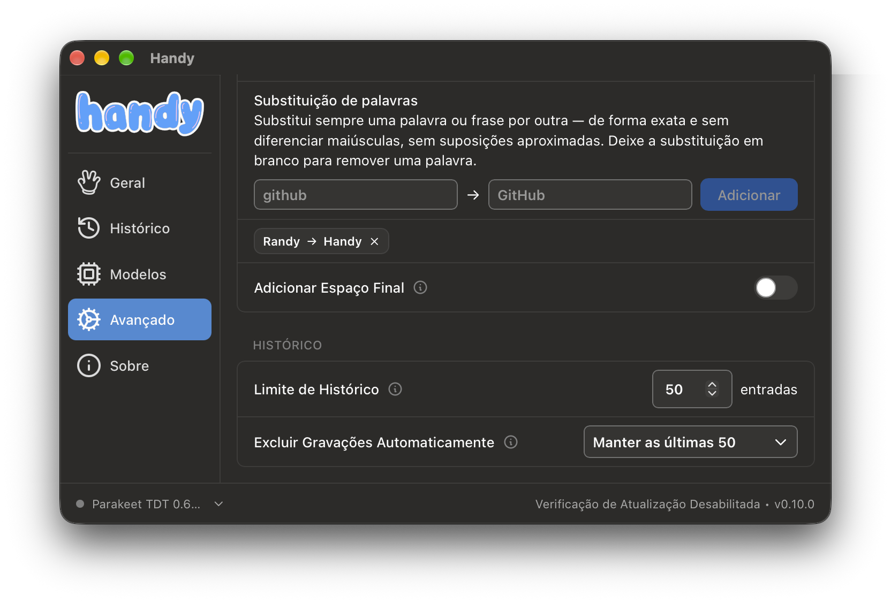
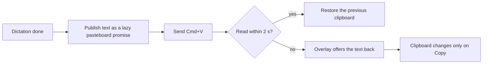
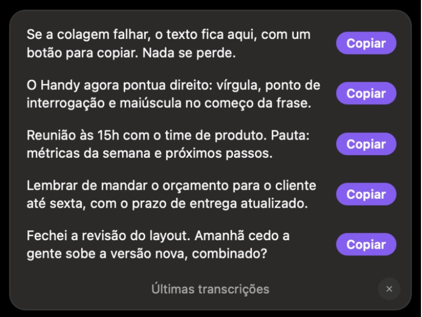
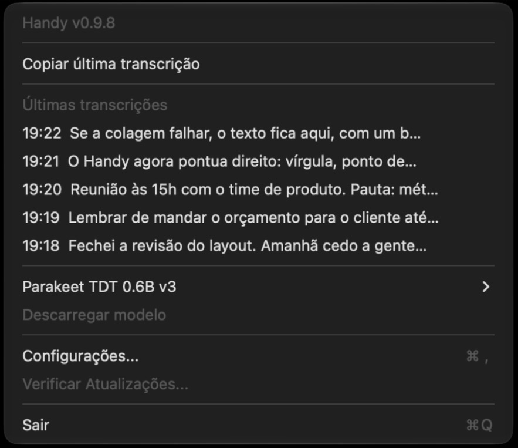

<div align="center">

# Handy, tuned

**A fork of [Handy](https://github.com/cjpais/Handy), the offline speech-to-text app, built around one rule: what you dictate never gets lost, and it reads like you wrote it. Based on Handy 0.10.0.**

[Download for macOS](https://github.com/LimaJoota/Handy/releases/latest) · [What changed](#what-changed) · [Design notes](#design-notes) · [Build](#build-from-source) · [Upstream README](https://github.com/cjpais/Handy#readme)



</div>

---

## Why this fork

I dictate all day in Portuguese: messages, specs, prompts, notes. Handy got the hard part right (fast, local, private), but three things kept costing me time:

1. **No punctuation.** The default streaming model wrote everything as one long run-on sentence.
2. **Lost text.** When a paste didn't land (focus moved, no text field), the transcript was gone unless I dug through History.
3. **Names it always got wrong.** The app's own name came out as "Randy", and the fuzzy custom-words matcher couldn't fix it without breaking ordinary words.

Plus the pink. Upstream has declined accent-color PRs twice ([#1232](https://github.com/cjpais/Handy/pull/1232), [#551](https://github.com/cjpais/Handy/pull/551)) and says visual preferences belong in forks, while [#1212](https://github.com/cjpais/Handy/discussions/1212) keeps collecting votes. So this is that fork.

Everything here stays local. Nothing is sent anywhere, and by default the clipboard is never touched without a click.

## What changed

|     | Feature                                                                                           | Where                             |
| --- | ------------------------------------------------------------------------------------------------- | --------------------------------- |
| 🎨  | **Accent color**: Pink, System, Purple or any custom color                                        | About → Accent Color              |
| ✍️  | **Real punctuation in Portuguese** by switching to Parakeet TDT 0.6B v3 (benchmarked below)       | Models                            |
| 🔁  | **Exact word replacements**: `Randy → Handy`, no fuzzy guessing                                   | Advanced → Word Replacements      |
| 🛟  | **Paste recovery**: if the target app never reads the paste, the overlay offers the text back     | Automatic, with reliable paste on |
| 📎  | **Copy if Not Pasted**: the transcript stays on the clipboard only when the paste missed          | Advanced → Clipboard Handling     |
| ⌥⇧H | **Last 5 transcripts on demand**, each with its own Copy                                          | Shortcut, rebindable in General   |
| 📋  | **Last 5 transcripts in the menu bar**, one click to copy                                         | Handy's tray menu                 |
| 🔐  | **No more stuck permissions after an update**: stale macOS grants are cleared before asking again | Onboarding                        |
| ⚡  | **Faster under load**: one CPU thread on Metal, and an idle model warms up while you talk         | Automatic on macOS                |

## Design notes

### 🎨 Accent color

**What.** One setting next to Theme: Pink (the brand default), System, Purple, or Custom with a color picker. It recolors buttons, switches, highlights, the wordmark and the recording overlay, in light and dark.

<p align="center"></p>

**How.** Handy's palette already flows from three source tokens in [`theme.css`](src/styles/theme.css): a light pastel, a dark pastel and a strong shade for filled controls. Every other color is a `color-mix()` of those. So the feature doesn't touch a single component: it sets `data-accent` on the document root and overrides only those three tokens.

```css
:root[data-accent="system"] {
  --accent-base: AccentColor;
}
:root[data-accent="custom"] {
  --accent-base: var(--accent-custom);
}

:root[data-accent="system"],
:root[data-accent="custom"] {
  --light-color-logo-primary: color-mix(in srgb, var(--accent-base) 50%, #fff);
  --dark-color-logo-primary: color-mix(in srgb, var(--accent-base) 70%, #fff);
  --color-background-ui: var(--accent-base);
}
```

**Decisions.**

- **System uses the CSS `AccentColor` keyword.** I checked in a bare `WKWebView` that WebKit resolves it to `NSColor.controlAccentColor` (`rgb(0, 122, 255)` with the default macOS accent) and that `color-mix()` works on top of it. Change your Mac's accent and Handy follows. Webviews that don't support the keyword simply don't offer the option.
- **One base color in, a full palette out.** System and Custom derive the pastel pair by mixing toward white, calibrated so the brand pink would come out close to its hand-picked values.
- **The overlay is a separate webview**, so it can't see the settings window's DOM. It re-reads the setting on an `accent-changed` event, the same pattern upstream uses for the theme.
- **No flash on launch.** The choice is mirrored to `localStorage` and applied before React mounts; `AppSettings` stays the source of truth.
- **The mascot's tongue stays pink.** It's a tongue.

### ✍️ Punctuation: pick the right model, don't bolt on a fixer

I ran the same real Portuguese dictation clips through each candidate with Handy's own headless CLI (`handy --transcribe-file`), on an M4:

| Model                                     | Punctuation                        | Time per clip   |
| ----------------------------------------- | ---------------------------------- | --------------- |
| Nemotron Streaming 3.5 (previous default) | almost none                        | streaming       |
| Whisper Large v3 Turbo (Q8)               | commas, but misses sentence breaks | 1.3 – 3.8 s     |
| **Parakeet TDT 0.6B v3 (Q8)**             | **commas, `?`, `!`, capitals**     | **0.1 – 0.4 s** |

Same clip, before and after:

> **Nemotron:** Inclua também um modelo com vírgulas né porque pelo amor de Deus está faltando vírgula em tudo que eu tô falando que loucura
>
> **Parakeet v3:** Inclua também um modelo com vírgulas, né? Porque, pelo amor de Deus, tá faltando vírgula em tudo que eu tô falando, que loucura!

**What I ruled out, and why:**

- **An LLM post-processing pass** (Apple Intelligence, local and free) adds a second model and latency to every dictation. It also wasn't available here: the on-device model reported `modelNotReady`, and builds made with only the Command Line Tools compile Handy's Apple Intelligence bridge as a stub, because the `FoundationModels` macro plugin ships with full Xcode.
- **LanguageTool as a correction step.** The macOS app has no local server, so it would mean sending dictation to the cloud, against Handy's local-first design. Its public API also only catches a couple of commas (before "mas", "aliás") on unpunctuated speech.

Choosing a model that punctuates natively beat every bolt-on: better output, ten times faster than Whisper, zero extra moving parts.

### 🔁 Exact word replacements

**Why fuzzy wasn't enough.** Custom Words matches with Levenshtein distance plus a Soundex boost. "randy" vs "handy" is distance 1 in 5 letters (0.2), above the 0.07 threshold I run. And Soundex doesn't help, because the first letter differs (`R530` vs `H530`). Raising the threshold to the 0.18 default fixes Randy and breaks Portuguese instead: "mas" became "MAX", "hoje" became "hook".

<p align="center"></p>

**How.** An exact, deterministic rule list: whole-word, case-insensitive, `from → to`. Replacement text is literal (`regex::NoExpand`, so `$` can't be read as a capture group), and an empty target deletes the term. It runs inside the transcription pipeline's fail-open transform: after custom words, before filler-word removal, so a bug in the rules can never cost you the transcript.

This is [cjpais/Handy#1533](https://github.com/cjpais/Handy/pull/1533) by **marko-kraemer**, merged onto current `main` here. Conflicts with the newer pipeline were resolved and the four locales added since were translated.

### 🛟 Paste recovery

**The signal.** Upstream's _reliable paste_ already knows whether the target app actually read the transcript. On macOS it publishes the text as a lazy pasteboard promise (`declareTypes:owner:`), and the pasteboard calls back `pasteboard:provideDataForType:` only when someone reads it.



**Decisions.**

- **2 seconds.** Real reads land around 100 ms after the chord. Two seconds is generous enough for a loaded machine and quick enough that you're still looking at the screen.
- **The clipboard is sacred.** The previous clipboard is restored on the usual schedule, and the card writes to it only when you click Copy. If you had an API key copied, it's still there.
- **No focus stealing.** The overlay is a non-activating panel, so you keep typing where you were. That's also why there is no Esc to close it: it never has keyboard focus. It closes after 10 s, stays open while the pointer rests on it, and has a close button.
- **Known limit, handled.** Some apps read the pasteboard on Cmd+V even with no text field focused, so the paste counts as delivered when it wasn't. Detection can't fix that, which is why there are two manual ways back below.

**Copy if Not Pasted**, [IaroslavMazur's idea](https://github.com/cjpais/Handy/discussions/1379#discussioncomment-19421565). Same signal, opposite trade-off: no click needed, at the cost of the clipboard when a paste misses. Read means restore the previous clipboard, no read means leave the transcript there. Off by default, and offered only with reliable paste on, since the legacy path has no such signal.

### ⌥⇧H and the menu bar: the manual ways back

**⌥⇧H** opens the same card with your last five transcripts, newest first, each with its own Copy. When a paste just failed, that one goes first under "Não colou?" ("Didn't paste?").

**The menu bar** lists the last five transcripts right in Handy's tray menu as `HH:MM  first words…`; click one and the full text is copied.

<table>
  <tr>
    <td align="center"><br><sub>⌥⇧H: the last five, one Copy each</sub></td>
    <td align="center"><br><sub>Menu bar: one click copies</sub></td>
  </tr>
</table>

**Decisions.**

- **Always visible, no submenu.** The first version hid the list behind a hover-only submenu; nobody found it. Now it sits under _Copy Last Transcript_.
- **No disk reads on the main thread.** Upstream computes the tray snapshot off the main thread on purpose, so a busy worker can never freeze the menu bar. The recent transcripts join that snapshot, full text included, so a click copies exactly what the menu showed without touching SQLite. The menu refreshes when History adds, updates or deletes an entry.
- **Labels that behave.** Whitespace collapsed to one line, cut at 48 characters with an ellipsis, and `&` escaped on Windows where menus read it as a mnemonic.

### 🔐 Permissions that survive an update

**The bug.** [#1618](https://github.com/cjpais/Handy/issues/1618): macOS ties a permission to the app's code signature. After an update the old entry stays in System Settings, looks switched on, and no longer matches the new build. macOS neither honors it nor asks again, so onboarding sits on "Waiting" until you clear it from a terminal. I hit it on every rebuild, for Accessibility and for the microphone.

**The fix.** Handy resets its own entry with `tccutil` right before asking, so macOS prompts and records the running build. It only runs while the permission reads as not granted, so a working grant can't be lost.

This ports the approach of [#2057](https://github.com/cjpais/Handy/pull/2057) by notenderdreams, whose target file was replaced in 0.10, and adds the microphone.

### ⚡ Speed on a busy Mac

**The problem.** Idle, Parakeet v3 is instant. With other work running on the Mac, a short dictation could take 20 s. Two separate causes:

- **Spinning threads.** GPU sessions default to 8 CPU threads that spin-wait between steps. On a busy CPU they fight everything else for cores, and the decoder ends up about 100× slower. A Metal session needs one.
- **An evicted model.** Under memory pressure macOS evicts an idle model from the GPU, so the first run after a pause pays to bring it back.

**The fix.** Metal sessions on macOS use one CPU thread. When recording starts on a model idle for 10 s or more, Handy decodes a second of silence in the background, then repeats every 15 s while you talk, so the model is ready when you stop. Streaming models skip this, since they decode from the first sample.

| 10 s clip, Parakeet v3                  | Before   | After       |
| --------------------------------------- | -------- | ----------- |
| Idle                                    | 170 ms   | 172 ms      |
| 10 normal-priority CPU jobs             | 992 ms   | 392 ms      |
| 12 low-priority CPU jobs                | 2211 ms  | 320 ms      |
| After a 45 s pause, 15 GB ML job on GPU | 2.2–20 s | 0.24–0.36 s |

Real dictations on the final build: 14 in a row, median 0.91 s, worst 2.96 s, including 30.6 s of audio in 0.95 s. Those ran with little memory pressure, so the table is the stress case.

**The cost.** Under that 15 GB load a warm-up takes 6–10 s, so a shorter dictation waits for the rest of it. Whisper Turbo and long audio didn't change.

**Tried, no benefit:** `GGML_METAL_NO_RESIDENCY`, `GGML_METAL_SHARED_BUFFERS_*` and thread QoS classes.

## Install

1. Download `Handy-macOS-arm64.zip` from [Releases](https://github.com/LimaJoota/Handy/releases/latest) (Apple Silicon).
2. Unzip and move **Handy.app** to Applications.
3. The build isn't notarized, so the first launch needs **System Settings → Privacy & Security → Open Anyway**.
4. Grant Microphone and Accessibility when asked.

Update checks point to upstream Handy, which would bring back the stock build. Turn them off in Debug settings (`Cmd+Shift+D`) to stay on this one.

## Build from source

```bash
git clone https://github.com/LimaJoota/Handy.git && cd Handy
bun install
mkdir -p src-tauri/resources/models
curl -L -o src-tauri/resources/models/silero-vad-v6.2-F32.gguf \
  https://huggingface.co/handy-computer/silero-vad-v6.2-gguf/resolve/main/silero-vad-v6.2-F32.gguf
CMAKE_POLICY_VERSION_MINIMUM=3.5 bun run tauri build --bundles app
```

Full platform notes are in [BUILD.md](BUILD.md).

## Engineering

- **Branches, one feature each**, all on Handy 0.10.0: [`feat/accent-color`](https://github.com/LimaJoota/Handy/tree/feat/accent-color), [`feat/word-replacements`](https://github.com/LimaJoota/Handy/tree/feat/word-replacements), [`feat/paste-recovery`](https://github.com/LimaJoota/Handy/tree/feat/paste-recovery) (includes the tray list), [`feat/tray-recent-transcripts`](https://github.com/LimaJoota/Handy/tree/feat/tray-recent-transcripts), [`feat/copy-if-not-pasted`](https://github.com/LimaJoota/Handy/tree/feat/copy-if-not-pasted), [`fix/macos-stale-permissions`](https://github.com/LimaJoota/Handy/tree/fix/macos-stale-permissions), [`perf/metal-single-thread`](https://github.com/LimaJoota/Handy/tree/perf/metal-single-thread), [`perf/warm-up-idle-model`](https://github.com/LimaJoota/Handy/tree/perf/warm-up-idle-model). [`pessoal`](https://github.com/LimaJoota/Handy/tree/pessoal) is all of them together and is what the release is built from.
- **Tests:** the full Rust suite passes (358 tests), including accent validation, settings salvage, replacement rules, lost-paste detection, tray labels, the history queries and warm-up timing.
- **Clean gates:** `tsc`, ESLint, Prettier, `cargo fmt` and the translation checker all pass.
- **i18n:** every new string ships in all 26 locales Handy supports.
- **Follows upstream patterns**: settings as typed Rust enums with salvage-on-load, Tauri commands mirrored in `bindings.ts`, events for cross-webview sync. Easy to rebase, easy to upstream piece by piece.

## Credits

[Handy](https://github.com/cjpais/Handy) by CJ Pais and contributors, MIT licensed. Word replacements by marko-kraemer ([#1533](https://github.com/cjpais/Handy/pull/1533)). Copy if Not Pasted is IaroslavMazur's idea ([#1379](https://github.com/cjpais/Handy/discussions/1379#discussioncomment-19421565)). Everything else in this fork by [LimaJoota](https://github.com/LimaJoota).
